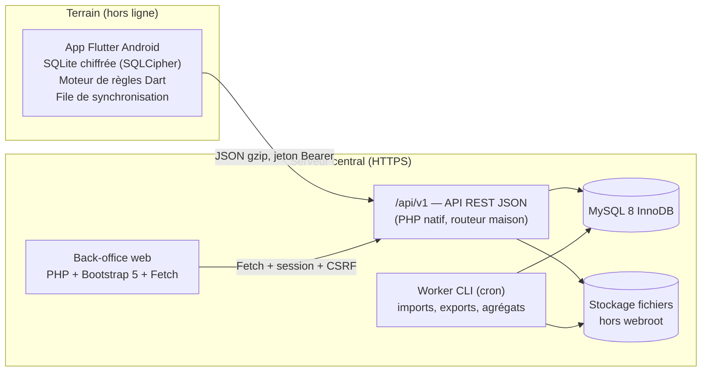
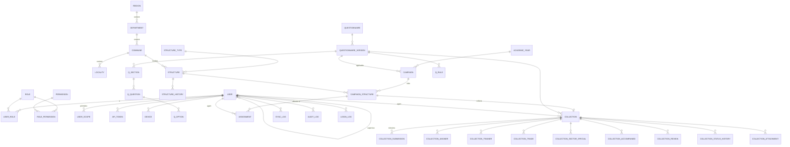
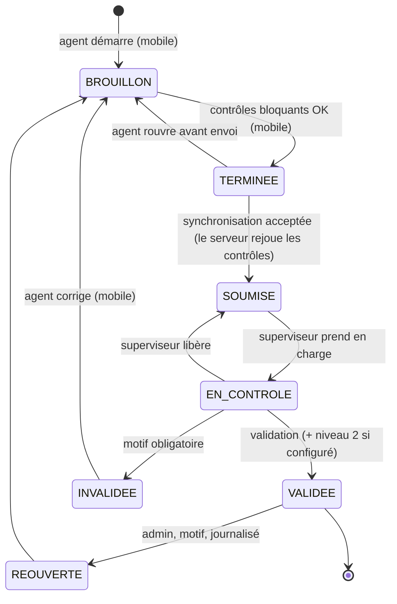

# Phase 1 — Architecture technique, modèle conceptuel et workflows

## 1. Vue d'ensemble



**Principe directeur : une seule API métier.** Le back-office web et le mobile consomment les mêmes endpoints `/api/v1`. Le web s'authentifie par session (cookie `HttpOnly`, `Secure`, `SameSite=Strict`) + jeton CSRF, le mobile par jeton Bearer. Toute règle (droits, périmètre, état de campagne, contrôles de cohérence) est donc implémentée **une seule fois, côté serveur**.

## 2. Choix techniques

| Domaine | Choix | Justification |
|---|---|---|
| Backend | PHP 8.3, sans framework, PSR-4 via Composer, architecture en couches (Controller → Service → Repository), conteneur d'injection minimal | Conforme au cahier des charges ; maintenable |
| Bibliothèques PHP (légères, non-frameworks) | `phpoffice/phpspreadsheet` (Excel), `dompdf/dompdf` (PDF), `phpunit/phpunit` (tests) | Valeur ajoutée réelle, bibliothèques maintenues |
| Base | MySQL 8.0 InnoDB, `utf8mb4_unicode_ci`, migrations SQL numérotées + table `schema_migrations` | Pas d'ORM ; PDO avec requêtes préparées exclusivement |
| Web | Bootstrap 5.3, Chart.js 4, DataTables 2 (mode **serveur** pour les grandes listes), Fetch API, modules ES6, Leaflet (carte des points GPS) | Pas de framework JS lourd |
| Mobile | Flutter stable / Dart 3, **Riverpod** (état), **Drift** sur **SQLCipher** (SQLite typé + migrations + chiffrement), `dio` (HTTP), `flutter_secure_storage` (Keystore Android), `geolocator`, `workmanager` (synchronisation en arrière-plan), `connectivity_plus` | Écosystème stable ; compilation iOS possible plus tard |
| Authentification API | Jetons **opaques** aléatoires de 256 bits, stockés **hachés** (SHA-256) ; accès 12 h + rafraîchissement 30 j avec rotation ; liaison à l'appareil ; révocation immédiate | Révocation simple en cas de perte de tablette — préférable aux JWT |
| Connexion hors ligne | Après une 1ʳᵉ connexion en ligne, vérificateur local (Argon2id du mot de passe) en stockage sécurisé ; déverrouillage hors ligne ; durée maximale hors ligne paramétrable (ex. 30 jours) | Indispensable en zone blanche |
| Mots de passe | `password_hash(PASSWORD_ARGON2ID)` | Exigence de sécurité |
| Tâches lourdes | Table `jobs` + worker CLI lancé par cron | Pas de dépendance à Redis/RabbitMQ |
| Statistiques | Tables d'agrégats (`stat_*`) mises à jour à chaque changement d'état d'une collecte + recalcul complet nocturne | Tableaux de bord rapides, aucun calcul dans des boucles PHP |

### 2.1 Questionnaire piloté par métadonnées

La définition du questionnaire (sections, questions, options, tableaux, règles) est un **document JSON versionné**, stocké dans `questionnaire_versions` et décomposé dans les tables `questionnaire_*` pour pouvoir être interrogé. La même définition est :
- téléchargée par le mobile, qui génère le formulaire dynamiquement ;
- interprétée par le serveur, qui rejoue les contrôles.

Les règles (`visible_if`, `required_if`, contraintes, gravité) utilisent un **mini-langage d'expressions** commun, avec deux interpréteurs (PHP et Dart) vérifiés par un **jeu de vecteurs de tests partagé** (`/shared/rules-fixtures/*.json`), exécuté à la fois par PHPUnit et par `flutter test`. C'est la garantie que le mobile et le serveur prennent exactement les mêmes décisions.

Une collecte est liée à la version du questionnaire utilisée : publier une v2 ne modifie jamais les collectes v1.

### 2.2 Stockage des réponses — modèle hybride

- **Réponses simples et choix multiples** (Sections I, II, V) → `collection_answers` (une ligne par question, et une ligne par option cochée pour un choix multiple). Ajouter une question dans une nouvelle version ne demande aucune migration.
- **Tableaux répétés du questionnaire** → tables dédiées et typées :
  - `collection_trainers` (Section III) ;
  - `collection_trades` (une ligne par métier : secteur, métier, durée) + 6 colonnes d'effectifs `p1_h, p1_f, p2_h, p2_f, p3_h, p3_f` ;
  - `collection_sector_specials` (secteur × catégorie [handicapés, réfugiés, retournés, déplacés] × promotion × sexe) ;
  - `collection_accompanied` (Q2.2 : durée × [inscrits, placés, outillés] × sexe).

Les grilles 2.1 et 2.19 ne sont pas stockées comme saisies : elles sont calculées depuis la Section IV et la Section III (décisions D-01 et D-08), puis matérialisées dans les agrégats et les exports.

On évite ainsi à la fois la « table géante » et l'EAV intégral, difficile à agréger. Les effectifs sont en `SMALLINT UNSIGNED` / `INT UNSIGNED`, avec contraintes `CHECK`.

### 2.3 Organisation des dossiers

```
/backend
  /public            index.php (contrôleur frontal API + web)
  /src
    /Core            Router, Request, Response, Container, Database, Config, Validator
    /Http/Middleware Auth, Csrf, RateLimit, Scope, Json, Maintenance
    /Modules/<Module>/{Controller,Service,Repository,Validator}.php
                     Auth, Users, Territory, Structures, Years, Campaigns,
                     Assignments, Questionnaires, Collections, Sync, Reviews,
                     Stats, Exports, Imports, Audit, Settings
    /Rules           Interpréteur du langage de règles
  /views             Gabarits PHP des pages web (layouts, components, pages)
  /bin               worker.php, migrate.php, seed.php
  /storage           logs, imports, exports, uploads (hors webroot)
  /tests             Unit, Integration, Security
/web/assets          css, js (modules ES6), vendor (versions figées)
/mobile              projet Flutter (lib/core, data, domain, features, sync, widgets)
/database            migrations, seeds, referentials (fichiers officiels), backups
/shared              questionnaire/v2024.json, rules-fixtures/
/docs                architecture, database, api, mobile, web, deployment, security, testing
/scripts             sauvegarde, déploiement, k6 (tests de charge)
```

## 3. Modèle conceptuel de données



### 3.1 Les quatre niveaux distingués (exigence §6)

| Niveau | Entité | Clé d'unicité |
|---|---|---|
| Structure permanente | `structures` | `id` (UUID), `official_code` UNIQUE |
| Structure ciblée par une campagne | `campaign_structures` | UNIQUE (`campaign_id`, `structure_id`) |
| Affectation à un agent | `assignments` | Un seul enregistrement actif par `campaign_structure_id` (colonne générée `active_key` UNIQUE) |
| Collecte / données statistiques de l'année | `collections` (+ tables filles) | UNIQUE (`campaign_structure_id`) et UNIQUE (`uuid`) |

Une collecte conserve un **instantané** de la localisation (`commune_id` au moment de la collecte) : un redécoupage ultérieur ne réécrit pas l'historique statistique.

### 3.2 Contraintes clés
- Clés étrangères `ON DELETE RESTRICT` sur toutes les données de collecte : rien ne se supprime en cascade.
- Suppression logique (`deleted_at`) pour les utilisateurs et les structures ; aucune suppression physique de collecte.
- Index composites pour les filtres des tableaux de bord : (`campaign_id`, `status`), (`campaign_id`, `region_id`, `department_id`, `commune_id`), (`agent_id`, `campaign_id`).
- Verrouillage optimiste : colonne `revision` sur `collections`, incrémentée à chaque soumission acceptée.

## 4. Workflows

### 4.1 Cycle de vie d'une collecte



Règles appliquées **côté serveur** :
- Soumission refusée (HTTP 409/423) si la campagne n'est pas `OUVERTE`, si l'agent n'est pas l'affectataire actif, ou si l'état serveur interdit la modification (`SOUMISE` tant que le superviseur n'a pas statué, `EN_CONTROLE`, `VALIDEE`).
- Chaque soumission crée une ligne immuable dans `collection_submissions` (charge utile complète + empreinte SHA-256) : l'historique des corrections est intégral.
- Synchronisée ≠ validée : seule l'action d'un superviseur fait passer à `VALIDEE`.

### 4.2 Synchronisation

```mermaid
sequenceDiagram
  participant App as Mobile (outbox SQLite)
  participant API as /api/v1/sync
  participant DB as MySQL
  App->>App: Terminer → élément outbox {uuid, base_revision, payload, sha256}
  loop Reprise avec temporisation exponentielle
    App->>API: POST /collections/{uuid}/submissions (Idempotency-Key = uuid:sha256)
    API->>DB: BEGIN ; SELECT … FOR UPDATE sur la collecte
    alt même empreinte déjà reçue
      API-->>App: 200 ACK (rejoué, aucun doublon)
    else base_revision = révision serveur et état modifiable
      API->>DB: contrôles + écriture + submission + historique ; COMMIT
      API-->>App: 201 ACK {server_revision, status: SOUMISE}
    else conflit (révision dépassée ou état verrouillé)
      API-->>App: 409 {server_state} — copie locale conservée « en conflit »
    end
  end
  App->>API: GET /sync/pull?since=cursor (affectations, statuts, motifs, référentiels)
```

- États visibles sur le mobile : *Local uniquement, En attente, En cours, Synchronisé, Échec, À resynchroniser*, plus *En conflit*.
- **Aucun écrasement silencieux** : en cas de conflit, la version serveur fait foi ; la version locale est conservée et signalée au superviseur.
- Les données ne sont supprimées de l'appareil qu'après accusé de réception **et** validation (ou clôture de la campagne + délai).

### 4.3 Workflows par profil

**Administrateur** : importer les référentiels → créer l'année → créer la campagne (version de questionnaire, dates, niveaux de validation) → importer/créer les comptes → cibler les structures → affecter → ouvrir → suivre → clôturer → archiver.

**Superviseur** : tableau de bord du périmètre → file « à contrôler » → prise en charge → examen (avec comparaison N-1 et anomalies signalées par les règles) → valider / invalider avec motif → suivi des corrections → relance des agents en retard.

**Agent** : 1ʳᵉ connexion en ligne → téléchargement des affectations, du questionnaire et des référentiels → collecte hors ligne (brouillon automatique, GPS) → terminer (contrôles) → synchronisation dès qu'il y a du réseau → consultation des statuts → correction des collectes invalidées.

## 5. Sécurité (principes retenus dès la conception)

- Contrôle d'accès en deux temps dans chaque service : **permission** (rôle) puis **périmètre** (clause SQL de portée injectée par un `ScopeService` — l'identifiant transmis par le client ne suffit jamais ⇒ protection IDOR).
- PDO avec requêtes préparées exclusivement, `ATTR_EMULATE_PREPARES=false`.
- Échappement systématique en sortie (`htmlspecialchars` dans les vues, `textContent` côté JS), en-têtes CSP, `X-Frame-Options`, HSTS.
- CSRF sur toutes les requêtes web modifiantes.
- Limitation des tentatives de connexion par compte et par IP (table `login_attempts`), verrouillage temporaire.
- Fichiers importés : extension + type MIME réel + taille maximale, stockage hors webroot sous un nom aléatoire, lecture par PhpSpreadsheet en mode données seules (formules non évaluées).
- Journal d'audit en ajout seul pour les opérations sensibles (comptes, validations, réouvertures, exports, changements d'état de campagne).
- Mobile : base SQLCipher, clé dans le Keystore Android, révocation à distance de l'appareil, effacement local après un nombre paramétrable d'échecs de déverrouillage.
